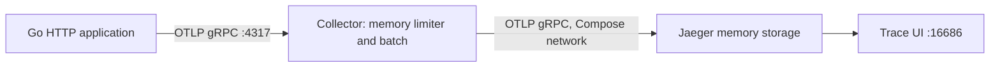

# Local Collector and Jaeger

[English](README.md) | [Русский](README.ru.md)

English is the original; the Russian translation is maintained alongside it.

This optional stack turns HTTP spans into a trace you can inspect. It pins
**OpenTelemetry Collector 0.164.0** and **Jaeger 2.22.0**. The application runs
on your host; the two backends run in Docker Compose.



## Start from module 01

Install Docker with Compose, use Linux containers, and make sure its engine is
running. From the repository root, change directory once; subsequent commands
in this page assume you remain in module 01.

```sh
cd 01-local-observability-stack
docker compose config --quiet
docker compose up -d --wait --wait-timeout 60
go run ./cmd/stack-ready -timeout=45s
```

The first start downloads images. `up --wait` only establishes running/healthy
container state; these minimal images have no configured container healthcheck.
`stack-ready` separately polls the actual HTTP readiness endpoints. Neither check
alone proves a span reached Jaeger; run the integration test below for that.

## Inspect a trace manually

In the same directory, start either application. Its default OTLP endpoint is
now `http://localhost:4317`, matching the host-published Collector port.

```sh
go run ./app-manual/cmd/server
```

In another terminal (`curl.exe` in Windows PowerShell):

```sh
curl -i 'http://localhost:8080/work?delay_ms=200'
curl -i 'http://localhost:8080/error?status=503'
```

Open [Jaeger UI](http://localhost:16686), choose `local-observability-app` in
Search, and find recent traces. Allow several seconds for both batch processors.
The `/work` request should contain `GET /work` and its child `service.work`.
The `/error` request should contain `GET /error` and `service.error`, both with
Error status and an HTTP status attribute of 503 on the server span.
Successful work normally has Unset status. Match the log's `trace_id` to the UI
to distinguish traces from different requests.

Stop the first application before starting `go run ./app-otelhttp/cmd/server`.
Both use port 8080 and the same default service name. To show separate service
entries, set `APP_NAME` before starting each app, as described in the module guide.

## Verify delivery automatically

These opt-in tests exercise **both real routers** on temporary HTTP ports, use
their real SDK/exporter, and read saved traces through Jaeger's v3 API:

```sh
go test -mod=readonly -tags=integration -run TestLocalStack -count=1 -v -timeout=90s ./app-manual/internal/server ./app-otelhttp/internal/server
```

Each app sends a successful and a 503 request with unique sampled remote parents.
The test flushes its SDK, polls until the expected span set appears, and checks
service name, preserved TraceID, server kind, HTTP status, error status, and the
business span's parent ID. It prints direct trace URLs. The simulated upstream
parent itself is not exported; the test deliberately checks its incoming ID.
The applications use distinct `workshop-*-integration` service names.

Ordinary `go test ./...` does not require Docker and does not run these tests.
`-tags=integration` requires live backends and fails when they are unavailable;
it does not silently skip the check. For nondefault backends, set
`WORKSHOP_OTLP_ENDPOINT` and `WORKSHOP_JAEGER_URL`. Readiness supports
`WORKSHOP_COLLECTOR_HEALTH` and `WORKSHOP_JAEGER_HEALTH` as well.

**Verification status:** Compose parsing, Go compilation, and local API-contract
tests have been checked. A live run of this stack and a UI screenshot are still
pending. The CI job is prepared to execute the full chain after publication.
Mock HTTP responses in unit tests are not evidence of backend interoperability.

## Ports and boundaries

| Host address | Purpose |
| --- | --- |
| `127.0.0.1:4317` | Collector OTLP/gRPC input for host applications |
| `127.0.0.1:16686` | Jaeger UI and query API |
| `127.0.0.1:13133/` | Collector HTTP readiness |
| `127.0.0.1:13134/status` | Jaeger HTTP readiness (container port 13133) |

Jaeger's OTLP port is internal to the Compose network, so the host app sends
through Collector. All published ports bind to loopback. This is an ephemeral,
unencrypted local teaching setup. Jaeger keeps at most 5,000 traces in memory;
restarting it loses traces. There are no persistent data volumes. Image release
tags are fixed; immutable image digests have not been verified.
Each app defaults to localhost when run on the host. An app in the Compose
network instead needs `http://otel-collector:4317`.

## Diagnose and stop

```sh
docker compose ps
docker compose logs --tail=100 otel-collector jaeger
docker compose down
```

If a host port is occupied, stop the conflicting process or change the published
port and the corresponding endpoint variables. A healthy receiver can still have
a broken exporter: inspect Collector export errors and use the stored-trace test.

Optional configuration validation uses the binaries inside the pinned images:

```sh
docker compose run --rm --no-deps otel-collector validate --config=/etc/otelcol/config.yaml
docker compose run --rm --no-deps jaeger validate --config=/etc/jaeger/config.yaml
```

These validation commands are included for the next live run; they have not yet
been executed in this environment. See [troubleshooting](../../docs/troubleshooting.md).

Configuration references: [Collector components](https://github.com/open-telemetry/opentelemetry-collector-releases/blob/v0.164.0/distributions/otelcol/manifest.yaml),
[Jaeger v2 configuration](https://github.com/jaegertracing/jaeger/blob/v2.22.0/cmd/jaeger/internal/all-in-one.yaml),
[Jaeger v3 query handler](https://github.com/jaegertracing/jaeger/blob/v2.22.0/cmd/jaeger/internal/extension/jaegerquery/internal/apiv3/http_gateway.go).
