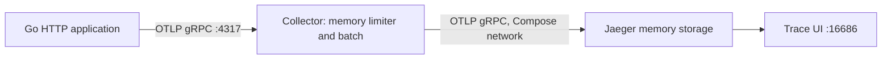

# Локальные Collector и Jaeger

[English](README.md) | [Русский](README.ru.md)

Английская версия — оригинал. Русский перевод поддерживается рядом с ней.

Этот дополнительный стенд позволяет увидеть HTTP-спаны в UI трасс.
Версии закреплены: **OpenTelemetry Collector 0.164.0**, **Jaeger 2.22.0**.
Приложение запускается на хосте, два бэкенда — в Docker Compose.



## Запуск из модуля 01

Нужен Docker с Compose и запущенным движком Linux-контейнеров.
Из корня репозитория один раз перейдите в каталог модуля; следующие команды
этой страницы выполняются из него.

```sh
cd 01-local-observability-stack
docker compose config --quiet
docker compose up -d --wait --wait-timeout 60
go run ./cmd/stack-ready -timeout=45s
```

При первом запуске скачиваются образы. `up --wait` проверяет только состояние
контейнеров running/healthy; в этих минимальных образах container healthcheck
не настроен. `stack-ready` отдельно опрашивает реальные HTTP-адреса готовности.
Ни одна из проверок сама не доказывает получение спана Jaeger: для этого ниже
есть интеграционный тест.

## Просмотр трассы вручную

В том же каталоге запустите приложение. OTLP-адрес по умолчанию теперь
`http://localhost:4317`, он соответствует порту Collector на хосте.

```sh
go run ./app-manual/cmd/server
```

В другом терминале (`curl.exe` в Windows PowerShell):

```sh
curl -i 'http://localhost:8080/work?delay_ms=200'
curl -i 'http://localhost:8080/error?status=503'
```

Откройте [Jaeger UI](http://localhost:16686), выберите `local-observability-app`
в Search и найдите свежие трассы. Дайте несколько секунд обоим batch processors.
В `/work` ожидаются `GET /work` и дочерний `service.work`.
В `/error` — `GET /error` и `service.error`, оба со статусом Error;
у серверного спана HTTP-атрибут статуса равен 503.
Успешная работа обычно имеет Unset. Сопоставьте `trace_id` из лога с UI,
чтобы отличать запросы.

Остановите первое приложение перед `go run ./app-otelhttp/cmd/server`.
Оба используют 8080 и одинаковое service name по умолчанию. Для отдельных
сервисов в UI задайте `APP_NAME` перед запуском каждого, как описано в модуле.

## Автоматическая проверка доставки

Эти дополнительные тесты вызывают **оба настоящих router** на временных
HTTP-портах, используют реальный SDK/экспортёр и читают сохранённые трассы
через API Jaeger v3:

```sh
go test -mod=readonly -tags=integration -run TestLocalStack -count=1 -v -timeout=90s ./app-manual/internal/server ./app-otelhttp/internal/server
```

Для каждого приложения отправляются успешный и 503-запрос с уникальными
sampled remote parents. Тест выгружает SDK, дожидается полного набора спанов
и проверяет service name, TraceID, серверный kind, HTTP-статус, статус ошибки
и ID родителя бизнес-спана. Выводятся прямые ссылки на трассы.
Имитируемый внешний родитель не экспортируется: проверяется его входящий ID.
Приложения используют разные service name `workshop-*-integration`.

Обычный `go test ./...` не требует Docker и не запускает эти тесты.
`-tags=integration` требует работающие бэкенды и падает при их недоступности,
а не пропускает проверку. Для других адресов задайте `WORKSHOP_OTLP_ENDPOINT`
и `WORKSHOP_JAEGER_URL`. Команда готовности также поддерживает
`WORKSHOP_COLLECTOR_HEALTH` и `WORKSHOP_JAEGER_HEALTH`.

**Статус проверки:** выполнены разбор Compose, компиляция Go и локальные тесты
API-контракта. Запуск живого стенда и скриншот UI ещё предстоят.
Задание CI подготовлено для полной проверки после публикации.
Подставные HTTP-ответы unit-тестов не доказывают совместимость с бэкендом.

## Порты и ограничения

| Адрес на хосте | Назначение |
| --- | --- |
| `127.0.0.1:4317` | Вход Collector OTLP/gRPC для приложений хоста |
| `127.0.0.1:16686` | UI и query API Jaeger |
| `127.0.0.1:13133/` | HTTP-готовность Collector |
| `127.0.0.1:13134/status` | HTTP-готовность Jaeger, внутри контейнера порт 13133 |

OTLP-порт Jaeger доступен только в сети Compose, поэтому приложение хоста
отправляет спаны через Collector. Все опубликованные порты привязаны к loopback.
Это временный локальный учебный стенд без шифрования. Jaeger хранит в памяти
не более 5000 трасс; перезапуск удаляет их. Постоянных томов данных нет.
Теги релизов образов закреплены, immutable digest ещё не проверены.
Приложение хоста использует localhost; приложение в сети Compose должно
использовать `http://otel-collector:4317`.

## Диагностика и остановка

```sh
docker compose ps
docker compose logs --tail=100 otel-collector jaeger
docker compose down
```

Если порт занят, остановите конфликтующий процесс или измените публикацию порта
и соответствующие переменные адресов. Готовый receiver может иметь сломанный
экспортёр: проверяйте ошибки экспорта Collector и тест сохранённых трасс.

Дополнительная валидация конфигураций выполняется бинарниками закреплённых образов:

```sh
docker compose run --rm --no-deps otel-collector validate --config=/etc/otelcol/config.yaml
docker compose run --rm --no-deps jaeger validate --config=/etc/jaeger/config.yaml
```

Эти команды оставлены для следующего живого запуска и ещё не выполнялись
в данном окружении. См. [диагностику](../../docs/troubleshooting.ru.md).

Источники конфигурации: [компоненты Collector](https://github.com/open-telemetry/opentelemetry-collector-releases/blob/v0.164.0/distributions/otelcol/manifest.yaml),
[конфигурация Jaeger v2](https://github.com/jaegertracing/jaeger/blob/v2.22.0/cmd/jaeger/internal/all-in-one.yaml),
[обработчик запросов Jaeger v3](https://github.com/jaegertracing/jaeger/blob/v2.22.0/cmd/jaeger/internal/extension/jaegerquery/internal/apiv3/http_gateway.go).
